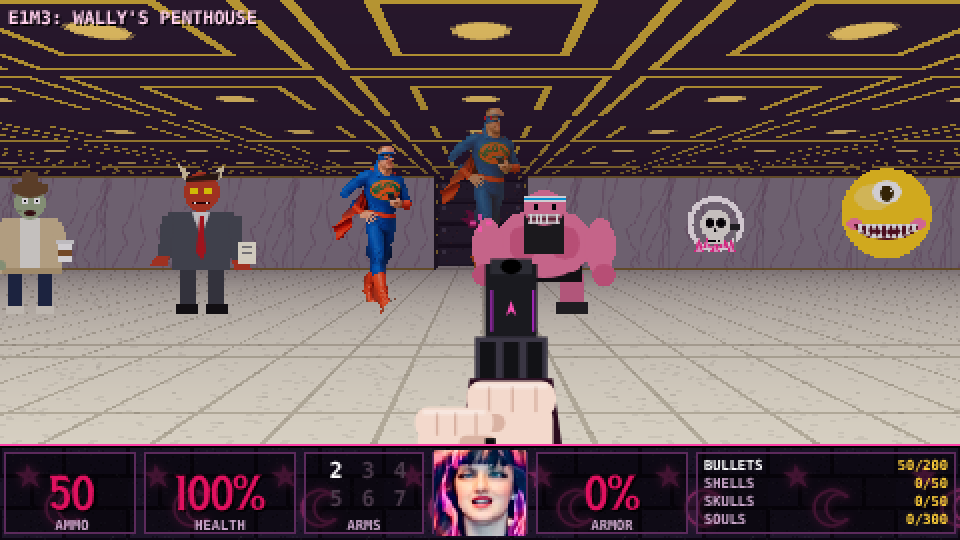

# GOFFICHICK

A gothic, retro first-person shooter in the style of the classic 90s shooters. It runs in any
browser with no install and no build step: open `index.html`.

> *The world has become unbearably cheerful. Goffichick is here to fix that.*



## Play

Open `goffichick/index.html` in a browser (double-click works, since all art is embedded).

| Keys | Action |
|---|---|
| WASD / arrow keys | Move / turn |
| Mouse | Look (click the game to lock the mouse) |
| Left click / Ctrl | Fire |
| E / Space | Press switches, open secret walls (doors open by themselves) |
| 1-9, Q, mouse wheel | Change weapon |
| Shift | Run |
| Tab | Automap |
| M | Music on/off |
| V | Goffichick's voice on/off |
| Esc / P | Pause |

On a phone or tablet, touch controls appear: the left stick moves, drag on the right side to look,
and there are FIRE / USE / WPN / MAP buttons.

**Cheats** (type them while playing): `gothmode` (god mode), `allblack` (every weapon, full ammo),
`nightfall` (skip the level).

## The heroine

**Goffichick** — The HUD face is her photo. It glances around, gets bloodier as she takes damage,
flinches when hit, and her eyes glow pink when she picks up a new weapon.

## Features

- **Title menu:** New Game, Continue (your progress is saved on your device at the start of every level), and
  three difficulty levels: *Mildly Gloomy*, *Properly Goth* and *Ultra Goth*.
- **Keys and locked doors:** find the **Bat key** (red), **Skull key** (blue) or **Coffin key** (gold) to open
  the matching coloured door. Keys you hold show on the status bar.
- **Stairs, ledges and lifts:** floors can be raised. Walk up steps, look down from balconies, and ride lifts:
  they sink when you come near, wait, then carry you up.
- **Power-ups:**
  - **Shadow Veil:** monsters can barely see you (30s).
  - **Night Shroud:** invulnerable (30s).
  - **Gas Mask:** toxic sludge is harmless (60s).
  - **Rage Heart:** your fists hit 10 times harder for the rest of the level.
- **Graphics:** coloured dynamic lighting (rockets, flames, explosions, plasma, torches, muzzle flashes and
  toxic sludge light up their surroundings), glow halos, sparks, blood spray and gibs, a panoramic sky outdoors, a
  shaded weapon that picks up the room's light, and an **HD / Classic** graphics option on the title menu.
- **Gamepads:** Xbox / PlayStation / Switch-style controllers. Left stick move, right stick turn, RT fire, A use,
  LB / RB change weapon, click the left stick to run, Back = map, Start = pause; the D-pad and A work in menus.
- **Achievements:** 15 to unlock (see ACHIEVEMENTS on the title menu). Using cheats switches them off for that run.
- **Atmosphere:** background sound for each level (wind, fluorescent hum, birds, rain), buzzing flickering lights,
  a metal clunk on locked doors, footsteps, and rain with lightning and thunder on stormy levels.
- **Monster infighting:** monsters that get hit by a different kind of monster turn on each other.
- **Goffichick's voice:** she comments on level starts, kills, bosses, pickups, secrets and getting hurt.
  The lines are spoken with the browser's speech voice and shown as subtitles. Press **V**, or use the title menu,
  to turn it off. To use **your own recordings**, put audio files in `assets/voice/` and list them in
  `VOICE_FILES` at the top of `js/voice.js`.
- **Scores and records:** every level is scored for kills, items, secrets and beating its par time, multiplied by
  difficulty. Your best time on each level is remembered. Finish the game to sign the top-10 **High Scores**
  table with your initials.
- **World leaderboard:** once the online leaderboard is set up (below), finished games are posted to a shared
  table, so friends anywhere can compete. The High Scores screen has **WORLD** and **THIS DEVICE** tabs.
- **Weekly challenge:** every Monday a new challenge starts: one level plus a twist, such as Pistol Start,
  Turbo Monsters, Glass Cannon, Lights Out, Rage Start or Full Arsenal. It's always played on Normal skill.
  - The fastest time to the exit wins.
  - Your best time this week is kept on the device.
  - A new personal best can be signed onto the **weekly speed-run board** that everyone shares (setup below).
  - The **QUIT** box at the top right (or Esc, then X) leaves a run.
- **Level editor:** draw your own maps on a phone or a computer:
  - **Placing things:** pick a tile on the right (walls, doors and keys, monsters, items, decorations) and draw
    on the map. Tap Goffichick's start again to turn her.
  - **Tools:** MOVE pans the map, ZOOM and UNDO work as you'd expect, SIZE makes the map 24 to 48 tiles square,
    and THEME changes the walls, floor, sky and music.
  - **Testing:** **PLAY** test-plays the level, and the **EDIT** box takes you back.
  - **Saving:** three levels are kept on the device (tap the SLOT button to switch), and you can tap the name to
    rename one.
  - **Sharing:** **SHARE** makes a link with the whole level packed inside it. When friends open the link, the
    title menu offers **PLAY FRIEND'S LEVEL**. No server is needed.

- **Online play (deathmatch and co-op):** choose **PLAY ONLINE** on the title screen.
  - **Hosting:** pick DEATHMATCH or CO-OP CAMPAIGN (and the level co-op starts at), then **HOST A NEW GAME**.
    Friends pick **JOIN A FRIEND'S GAME** and type the 3-letter room code. The host presses **START**.
  - **Deathmatch:** played in *DM1: The Mosh Pit*. The first player to 10 frags wins, or whoever leads after
    10 minutes. Pickups come back after 25 seconds. Other players look like goth Wally Men with a coloured trim
    and their name above them.
  - **Co-op:** play the campaign together. The host's game runs the monsters, and monsters go after whoever is
    closest. Pickups taken by one player disappear for everyone, but each player collects their own keys.
    Anyone reaching the exit ends the level for everyone, and the host chooses when to carry on.
  - **Players and limits:** up to 4 players. Online play uses the same Supabase project as the leaderboard,
    through **Realtime broadcast**, so no extra tables are needed. Realtime is switched on in new projects.

## Setting up the world leaderboard (Supabase, free)

1. Create a free account at [supabase.com](https://supabase.com) and a **New project** (any name and region).
2. Open **SQL Editor** in the project, paste this in and press **Run**:

   ```sql
   create table public.scores (
     id bigint generated always as identity primary key,
     name text not null check (name ~ '^[A-Z0-9 ?]{1,3}$'),
     score integer not null check (score between 1 and 100000),
     difficulty smallint not null default 1 check (difficulty between 0 and 2),
     created_at timestamptz not null default now()
   );
   alter table public.scores enable row level security;
   create policy "Anyone can read scores" on public.scores for select to anon using (true);
   create policy "Anyone can add a score" on public.scores for insert to anon with check (true);
   ```

   Players can only read scores and add new ones; nobody can edit or delete them from the game. You can
   remove silly entries yourself in Supabase's **Table Editor**.
   For the **weekly challenge board**, run this too. If you skip it, the game still works and keeps weekly
   times on each device.

   ```sql
   create table public.times (
     id bigint generated always as identity primary key,
     week integer not null check (week between 1 and 100000),
     name text not null check (name ~ '^[A-Z0-9 ?]{1,3}$'),
     time_ms integer not null check (time_ms between 5000 and 36000000),
     created_at timestamptz not null default now()
   );
   alter table public.times enable row level security;
   create policy "Anyone can read times" on public.times for select to anon using (true);
   create policy "Anyone can add a time" on public.times for insert to anon with check (true);
   ```
3. In **Project Settings → API**, copy the **Project URL** and the **anon public** key into
   `SUPABASE_URL` and `SUPABASE_ANON_KEY` at the top of `js/leaderboard.js`.

## Enemies

| Map letter | Enemy | Role (classic shooter equivalent) | Attack |
|---|---|---|---|
| `z` | **Latte Zombie** | Weak grunt | Flings scalding pumpkin-spice latte (hitscan) |
| `m` | **Middle Manager** | Fireball thrower | Hurls flaming memos, claws up close |
| `w` | **WALLY MAN** | Mid-tier soldier | Fires a 3-way spread of "reply-all" notifications from his phone |
| `b` | **Gym Brute** | Fast charging melee demon | Bites. Hard. |
| `i` | **Influencer Skull** | Flying kamikaze skull | Haloed by its ring light, dive-bombs you |
| `h` | **Smiley Orb** | Floating heavy | One eye, too many teeth, spits sunshine balls |
| `K` | **WALLY PRIME** | Final boss | Golden, red-eyed giant Wally. Exploding phones and notification barrages. Gets angrier below half health |
| `y` | Pumpkin-Spice Barrel | Explosive barrel | Shoot it near enemies |

### Episode 2 enemies

| Map letter | Enemy | Attack |
|---|---|---|
| `g` | **Yoga Instructor** | Throws calming chakra orbs that slow you down, and sidesteps when you shoot at her |
| `l` | **Life Coach** | Shouts motivational slogans; the sound waves slow you down |
| `x` | **Bubbly Orb** | Pink Smiley Orb that pops into two fast Mini Orbs when killed |
| `f` | **WALLY MAN FIT** | Red-suited, fast Wally Man who punches |
| `d` | **WALLY MAN DELUXE** | Black-and-gold, tough Wally Man who throws exploding phones |
| `J` | **MEGA SMILEY** | Episode 2 boss: a giant orange grin that sprays sunshine and spits out Mini Orbs |

### Episode 3 enemies

| Map letter | Enemy | Attack |
|---|---|---|
| `?` | **Bridezilla** | Storms in at double speed when close, slaps, and throws exploding bouquets |
| `€` | **Redcoat Entertainer** | Juggles three balls at you at once, and sidesteps your shots |
| `§` | **WALLY LIVE!** | Final boss: a giant sequinned TV-presenter Wally. Spotlight blasts, rings of applause, and he calls in Wally Man FIT backing dancers |

## Weapons

Goffichick starts with **every weapon**: press 1-8 (press a number twice to swap between two weapons in the
same slot), Q, or scroll. Weapon pickups on the maps give ammo for that weapon.


| Slot | Weapon | Ammo | Notes |
|---|---|---|---|
| 1 | **Spiked Knuckles** | none | Melee |
| 2 | **Hex Pistol** | bullets | First shot is pinpoint accurate |
| 3 | **Shotgun** | shells | Pump-action, 7 pellets |
| 3 | **Coffin Shotgun** | 2 shells | Double barrel, 20 pellets, coffin-shaped stock with a silver bat |
| 4 | **Machine Gun** | bullets | Fast, fully automatic |
| 4 | **Gatling Gun** | bullets | Six spinning barrels |
| 5 | **Rocket Launcher** | rockets | Big splash damage, including to you |
| 5 | **Skull Launcher** | skulls | Explosive flaming skulls |
| 6 | **Hexcaster** | souls | Rapid-fire purple plasma |
| 8 | **Flamethrower** | fuel | Short-range stream of fire; sets enemies (and barrels) alight so they keep burning |
| 1 | **Chainsaw** | none | Press 1 for the chainsaw, again for the knuckles; cuts continuously |
| 9 | **Bat-Bow** | bolts | Crossbow firing silver bat bolts that pierce every monster in a line |
| 9 | **Doom Scroll** | 2 souls | A phone that zaps a monster with lightning, which jumps to 2 more nearby |
| 7 | **B.F.G. (Big Freakin' Gloom)** | 40 souls | Charges, then fires a gloom orb. On impact it also hits everything in front of you |

## Music

Each level has its own synthesized song, about 1.5 minutes long before it repeats, built from several sections
(intro, verses, breakdowns, a heavier chorus) with their own chords, drums, bass, arpeggios and melodies:
*Cemetery Gates* (E1M1), *Fluorescent Dread* (E1M2) and *Penthouse Showdown* (E1M3). Songs live in `SONGS`
in `js/audio.js` and are easy to edit: each section is a list of chords plus a few style switches.

## Levels

Press a number again to swap between two weapons in the same slot.

Levels have doors that open as you approach, secret walls (press USE on suspicious walls), toxic
green sludge that burns, and dark rooms with flickering lights.


1. **E1M1: The Cemetery Gates** — start room, zig-zag hall, a big courtyard with a slime pool and armor on an island, a dark crypt with ambush alcoves, a stained-glass chapel, a hidden machine-gun stash, and a winding route to the exit
2. **E1M2: Cubicle Hell** — an office of smiley-face wallpaper and motivational posters
3. **E1M3: Wally's Penthouse** — marble, Wally shrines and the boss fight

### Episode 2: The Sunny Side

4. **E2M1: Shopping Maul**: an atrium with escalator stairs up to a mezzanine of shops, a lift, a food court with a
   toxic smoothie spill, and a department-store exit behind the skull door.
5. **E2M2: Gains Gym**: a raised boxing ring, a running track reached by lift or stairs, protein-sludge showers and
   a sauna exit behind the bat door.
6. **E2M3: Sunshine Park**: open sky, hedges, a hedge maze hiding the coffin key, a funhouse, a toxic duck pond, a
   bandstand, and the Mega Smiley's arena.

### Episode 3: The Big Day

7. **E3M1: Wedding Bells**: a reception with a raised dance floor and top table, a bridal suite, a kitchen with spilled
   punch, and the chapel exit behind the bat door.
8. **E3M2: Happy Days Holiday Camp**: outdoors in the rain with lightning: chalets, a toxic swimming pool, a
   lifeguard tower reached by lift, and the ballroom exit behind the skull door.
9. **E3M3: Studio 7**: a TV studio with stepped audience seating, ON AIR signs, and **WALLY LIVE!** on stage.

Each level has its own music track.

## Project layout

```
index.html          page + touch controls
js/game.js          raycasting engine, AI, combat, HUD, game flow (ENEMY_DEFS, PROJECTILES)
js/weapons.js       WEAPONS + AMMO_TYPES, with first-person weapon art
js/sprites.js       enemy / item / decoration / effect art (canvas-drawn) + Wally Man frames
js/textures.js      wall, floor and ceiling textures
js/levels.js        maps and the map legend
js/audio.js         synthesized sound effects and music (WebAudio)
js/voice.js         Goffichick's voice lines (browser speech, or your own recordings)
js/leaderboard.js   the shared world leaderboard and weekly board (Supabase)
js/editor.js        the level editor, level themes and share-link codes
js/net.js           online play over Supabase Realtime (rooms, broadcast messages)
js/photo-data.js    the two photos, processed and embedded so the game works from file://
assets/             the processed photo assets (Wally Man cut-out, HUD faces, title image)
```

## Adding more weapons

Weapons are data-driven. The top of `js/weapons.js` explains each field in detail. In short:

1. Add an entry to `WEAPONS` with a `slot`, `name`, `ammo`, `cooldown`, a `type`
   (`melee`, `hitscan` or `projectile`) and a `draw()` function for the first-person view.
2. For a projectile weapon, add a projectile to `PROJECTILES` in `js/game.js` and its sprite to
   `S.proj` in `js/sprites.js`.
3. Add a pickup: a letter in `ITEM_TYPES` (`js/levels.js`) and a sprite in `S.item` (`js/sprites.js`),
   then put that letter somewhere on a map.

The HUD, weapon switching, ammo and pickups all handle the new weapon automatically.

## Adding enemies or levels

- **Enemy:** add stats to `ENEMY_DEFS` in `js/game.js`, art to `build()` in `js/sprites.js`
  (walk ×2 and attack frames; pain and death frames are generated), and a letter in `ENEMY_CHARS`.
- **Level:** add an entry to `LEVELS` in `js/levels.js`. Every row must be the same width, and the
  map needs a player start (`>`), plus an `X` exit switch on a wall (or `boss: true`).
